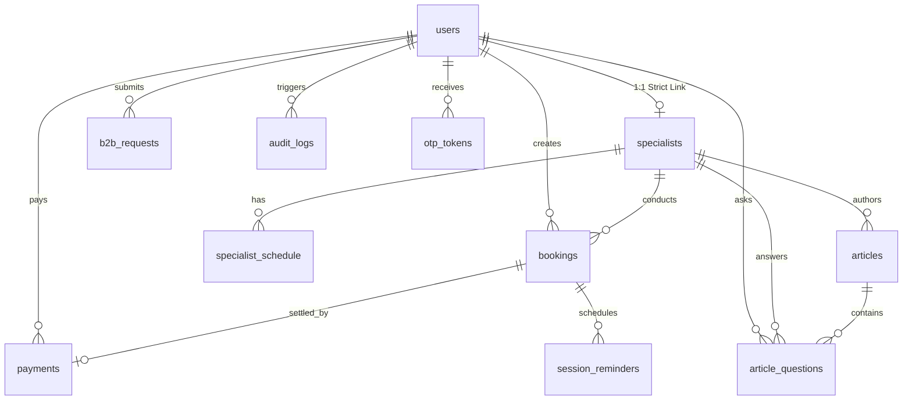

# توثيق قاعدة بيانات منصة PsyAI (PostgreSQL Database Documentation)

يقدم هذا المستند دليلاً شاملاً ومفصلاً للبنية الهندسية لقاعدة بيانات منصة **PsyAI** المبنية على محرك **PostgreSQL** المعتمد في ملف [`Psyi.sql`](file:///c:/Users/user/Downloads/psyai/Psyi.sql)، والمتوافقة بالكامل مع قواعد الأمان والخصوصية الصارمة للمنصة.

---

## 1. النظرة العامة والمعمارية (Architecture Overview)

* **محرك قاعدة البيانات:** PostgreSQL 15+ مع تفعيل إضافة التشفير الرسمية `pgcrypto`.
* **مستوى أمان البيانات:** تشفير الحقول الحساسة على مستوى الحقل (Field-Level Encryption - AES-256-GCM) مع فهارس عمياء مشفرة مجزأة (Blind Indexing - HMAC-SHA256) للبحث السريع والتفرد دون كشف البيانات الصريحة.
* **سجلات التدقيق:** سجلات غير قابلة للحذف أو التعديل نهائياً (Append-Only Immutable Logs) محمية بمحفزات قاعدة البيانات (Database Triggers).
* **إدارة الحسابات:** معمارية متقدمة تعتمد المعرفات الفريدة العالمية (UUIDv4) مع ربط صارم (1:1) بين حساب المستخدم وملف الأخصائي.

---

## 2. مخطط العلاقات الكينونية (Entity Relationship Diagram - ERD)



---

## 3. التعدادات المخصصة (Custom ENUM Types)

| اسم التعداد (Enum Name) | القيم المعتمدة (Values) | الاستخدام والوصف |
| :--- | :--- | :--- |
| `gender_enum` | `'male'`, `'female'` | جنس المستخدم (ذكر / أنثى) |
| `spec_gender_pref_enum` | `'any'`, `'male'`, `'female'` | تفضيل جنس الأخصائي المعالج |
| `language_enum` | `'ar'`, `'en'` | لغة واجهة وتنبيهات المستخدم |
| `user_status_enum` | `'active'`, `'inactive'`, `'suspended'` | حالة الحساب في المنصة |
| `user_role_enum` | `'user'`, `'specialist'`, `'admin'` | الرتبة والصلاحيات الأساسية |
| `booking_status_enum` | `'pending'`, `'confirmed'`, `'completed'`, `'cancelled'`, `'no_show'` | دورة حياة موعد الجلسة الاستشارية |
| `payment_status_enum` | `'PENDING'`, `'SUCCEEDED'`, `'FAILED'`, `'REFUNDED'` | حالة عملية الدفع الإلكتروني عبر بوابة Visa |
| `article_status_enum` | `'draft'`, `'published'`, `'archived'` | حالة نشر المقال التثقيفي في المدونة |
| `moderation_status_enum` | `'pending'`, `'published'`, `'rejected'` | حالة إشراف الأسئلة العامة على المقالات |
| `b2b_status_enum` | `'pending'`, `'approved'`, `'rejected'` | حالة طلب اعتماد الشركات والمؤسسات |
| `reminder_type_enum` | `'24h'`, `'1h'`, `'session_link'` | نوع تذكير الموعد المرسل عبر WhatsApp/SMS |
| `reminder_status_enum` | `'pending'`, `'sent'`, `'failed'` | حالة إرسال التذكير الآلي |
| `day_enum` | `'Sunday'`, `'Monday'`, `'Tuesday'`, `'Wednesday'`, `'Thursday'`, `'Friday'`, `'Saturday'` | أيام الأسبوع لجدول دوام الأخصائي |

---

## 4. الجداول التفصيلية لقاعدة البيانات (Database Tables)

### 1. جدول المستخدمين (`users`)
الجدول الأساسي لجميع الحسابات (عملاء، أخصائيين، مدراء).

| الحقل (Column) | النوع (Data Type) | القيود والفهارس (Constraints & Indices) | الوصف |
| :--- | :--- | :--- | :--- |
| `id` | `UUID` | `PRIMARY KEY DEFAULT gen_random_uuid()` | المعرف الفريد للمستخدم |
| `first_name` | `VARCHAR(100)` | `NOT NULL` | الاسم الأول للمستخدم |
| `last_name` | `VARCHAR(100)` | `NOT NULL` | اسم العائلة للمستخدم |
| `email_encrypted` | `TEXT` | `NOT NULL` | البريد الإلكتروني مشفر بـ AES-256-GCM |
| `email_hash` | `VARCHAR(64)` | `NOT NULL UNIQUE INDEX` | تجزئة HMAC-SHA256 للبحث السريع ومنع التكرار |
| `phone_encrypted` | `TEXT` | `NOT NULL` | رقم الهاتف مشفر بـ AES-256-GCM |
| `phone_hash` | `VARCHAR(64)` | `NOT NULL UNIQUE INDEX` | تجزئة HMAC-SHA256 للبحث السريع بالهاتف |
| `password_hash` | `VARCHAR(255)` | `NOT NULL` | كلمة المرور مشفرة بواسطة Argon2id / Bcrypt |
| `gender` | `gender_enum` | `NOT NULL` | الجنس (ذكر / أنثى) |
| `condition_encrypted` | `TEXT` | `NULLABLE` | وصف الحالة أو الاستشارة مشفر لحماية الخصوصية |
| `spec_gender_pref` | `spec_gender_pref_enum` | `DEFAULT 'any'` | تفضيل جنس الأخصائي |
| `role` | `user_role_enum` | `DEFAULT 'user' NOT NULL` | رتبة المستخدم (`user`, `specialist`, `admin`) |
| `is_verified` | `BOOLEAN` | `DEFAULT FALSE NOT NULL` | حالة تأكيد رقم الهاتف عبر رمز التحقق OTP |
| `token_version` | `INTEGER` | `DEFAULT 0 NOT NULL` | رقم إصدار التوكن لإنهاء الجلسات فوراً عند تعديل الأمان |
| `language` | `language_enum` | `DEFAULT 'ar'` | لغة التطبيق المفضلة |
| `status` | `user_status_enum` | `DEFAULT 'active' NOT NULL`, `INDEX` | حالة تفعيل الحساب |
| `created_at` | `TIMESTAMP` | `DEFAULT CURRENT_TIMESTAMP NOT NULL` | تاريخ ووقت إنشاء الحساب |
| `updated_at` | `TIMESTAMP` | `DEFAULT CURRENT_TIMESTAMP NOT NULL` | تاريخ ووقت آخر تعديل |

---

### 2. جدول الأخصائيين النفسيين (`specialists`)
بيانات الأخصائيين المرخصين مع ربط فريد ومباشر 1:1 بجدول المستخدمين.

| الحقل (Column) | النوع (Data Type) | القيود والفهارس (Constraints & Indices) | الوصف |
| :--- | :--- | :--- | :--- |
| `id` | `UUID` | `PRIMARY KEY DEFAULT gen_random_uuid()` | المعرف الفريد للأخصائي |
| `user_id` | `UUID` | `NOT NULL UNIQUE REFERENCES users(id) ON DELETE CASCADE` | المعرف المرجعي للمستخدم الأساسي |
| `name` | `VARCHAR(255)` | `NOT NULL` | الاسم المهني الكامل للأخصائي |
| `title` | `VARCHAR(255)` | `NOT NULL` | المسمى الوظيفي والأكاديمي |
| `specialty` | `VARCHAR(255)` | `NOT NULL` | مجالات التخصص (القلق، الاكتئاب، العلاقات، ...) |
| `bio` | `TEXT` | `NULLABLE` | نبذة عن الخبرات والشهادات العلمية |
| `price` | `NUMERIC(10, 2)` | `NOT NULL CHECK (price >= 0)` | سعر الجلسة بالريال السعودي |
| `rating` | `NUMERIC(2, 1)` | `DEFAULT 0.0` | التقييم المحسوب تلقائياً من الجلسات المكتملة |
| `is_featured` | `BOOLEAN` | `DEFAULT FALSE` | ظهور الأخصائي في الصفحة الرئيسية كأخصائي مميز |
| `license_number` | `VARCHAR(100)` | `NULLABLE` | رقم رخصة المزاولة المهنية المعتمدة |
| `created_at` | `TIMESTAMP` | `DEFAULT CURRENT_TIMESTAMP NOT NULL` | تاريخ إضافة الأخصائي |

* **الفهارس:** `idx_specialists_user_id`, `idx_specialists_featured_rating (is_featured, rating DESC)`.

---

### 3. جدول مواعيد ودوام الأخصائي (`specialist_schedule`)
إدارة أوقات العمل المتاحة للحجز لكل أخصائي.

| الحقل (Column) | النوع (Data Type) | القيود والفهارس (Constraints & Indices) | الوصف |
| :--- | :--- | :--- | :--- |
| `id` | `UUID` | `PRIMARY KEY DEFAULT gen_random_uuid()` | معرف الموعد |
| `specialist_id` | `UUID` | `NOT NULL REFERENCES specialists(id) ON DELETE CASCADE` | معرف الأخصائي |
| `day` | `day_enum` | `NOT NULL` | يوم العمل (Sunday إلى Saturday) |
| `start_time` | `TIME` | `NOT NULL` | وقت بداية فترة الاستشارات |
| `end_time` | `TIME` | `NOT NULL` | وقت نهاية فترة الاستشارات |
| `available` | `BOOLEAN` | `DEFAULT TRUE` | توفر الفترة للحجز |

---

### 4. جدول حجوزات الجلسات (`bookings`)
سجل الجلسات الاستشارية مع التقييمات المدمجة.

| الحقل (Column) | النوع (Data Type) | القيود والفهارس (Constraints & Indices) | الوصف |
| :--- | :--- | :--- | :--- |
| `id` | `UUID` | `PRIMARY KEY DEFAULT gen_random_uuid()` | المعرف الفريد للحجز |
| `user_id` | `UUID` | `NOT NULL REFERENCES users(id) ON DELETE RESTRICT` | معرف العميل صاحب الحجز |
| `specialist_id` | `UUID` | `NOT NULL REFERENCES specialists(id) ON DELETE RESTRICT` | معرف الأخصائي المعالج |
| `session_time` | `TIMESTAMP` | `NOT NULL` | موعد الجلسة الاستشارية |
| `status` | `booking_status_enum` | `DEFAULT 'pending' NOT NULL` | حالة الحجز |
| `meeting_link` | `VARCHAR(500)` | `NULLABLE` | رابط غرفة الاجتماع المباشرة للجلسة |
| `notes` | `TEXT` | `NULLABLE` | ملاحظات سرية خاصة بالجلسة |
| `rating` | `NUMERIC(2, 1)` | `CHECK (rating IS NULL OR (rating >= 1.0 AND rating <= 5.0))` | تقييم الجلسة من 1 إلى 5 |
| `review_notes` | `TEXT` | `NULLABLE` | تعليق وملاحظات العميل على الجلسة |
| `reviewed_at` | `TIMESTAMP` | `NULLABLE` | وقت تسجيل التقييم |
| `created_at` | `TIMESTAMP` | `DEFAULT CURRENT_TIMESTAMP NOT NULL` | تاريخ إنشاء الحجز |
| `updated_at` | `TIMESTAMP` | `DEFAULT CURRENT_TIMESTAMP NOT NULL` | تاريخ آخر تحديث |

---

### 5. جدول عمليات الدفع الإلكتروني (`payments`)
عمليات السداد عبر بوابة Visa Hosted Checkout مع ميزة منع التكرار.

| الحقل (Column) | النوع (Data Type) | القيود والفهارس (Constraints & Indices) | الوصف |
| :--- | :--- | :--- | :--- |
| `id` | `UUID` | `PRIMARY KEY DEFAULT gen_random_uuid()` | معرف عملية الدفع |
| `booking_id` | `UUID` | `NOT NULL REFERENCES bookings(id) ON DELETE RESTRICT` | معرف الحجز المرتبط |
| `user_id` | `UUID` | `NOT NULL REFERENCES users(id) ON DELETE RESTRICT` | معرف العميل الدافع |
| `amount` | `NUMERIC(10, 2)` | `NOT NULL CHECK (amount > 0)` | قيمة المبلغ المسدد |
| `currency` | `VARCHAR(10)` | `DEFAULT 'SAR' NOT NULL` | عملة الدفع (افتراضياً SAR) |
| `status` | `payment_status_enum` | `DEFAULT 'PENDING' NOT NULL` | حالة العملية (`PENDING`, `SUCCEEDED`, `FAILED`, `REFUNDED`) |
| `idempotency_key` | `VARCHAR(255)` | `NOT NULL UNIQUE` | مفتاح فريد يمنع تكرار خصم المبالغ لنفس الطلب |
| `visa_session_id` | `VARCHAR(255)` | `UNIQUE` | معرف جلسة الدفع المستضافة من بوابة Visa |
| `transaction_id` | `VARCHAR(255)` | `UNIQUE` | المعرف المرجعي للحركة المالية من البنك |
| `created_at` | `TIMESTAMP` | `DEFAULT CURRENT_TIMESTAMP NOT NULL` | وقت محاولة الدفع |
| `updated_at` | `TIMESTAMP` | `DEFAULT CURRENT_TIMESTAMP NOT NULL` | وقت تحديث حالة السداد |

* **الفهارس:** `unique_active_payment_per_booking` (فهرس فريد مشروط لمنع وجود أكثر من عملية دفع ناجحة لنفس الحجز).

---

### 6. جدول مقالات المدونة (`articles`)
المقالات التثقيفية المنشورة بواسطة الأخصائيين النفسيين.

| الحقل (Column) | النوع (Data Type) | القيود والفهارس (Constraints & Indices) | الوصف |
| :--- | :--- | :--- | :--- |
| `id` | `UUID` | `PRIMARY KEY DEFAULT gen_random_uuid()` | معرف المقال |
| `specialist_id` | `UUID` | `NOT NULL REFERENCES specialists(id) ON DELETE CASCADE` | معرف الأخصائي كاتب المقال |
| `title` | `VARCHAR(255)` | `NOT NULL` | عنوان المقال |
| `category_slug` | `VARCHAR(150)` | `NOT NULL` | التصنيف (مثل `anxiety`, `depression`, `relationships`) |
| `body` | `TEXT` | `NOT NULL` | محتوى ونص المقال التثقيفي |
| `status` | `article_status_enum` | `DEFAULT 'draft' NOT NULL` | حالة المقال (`draft`, `published`, `archived`) |
| `created_at` | `TIMESTAMP` | `DEFAULT CURRENT_TIMESTAMP NOT NULL` | وقت إنشاء المقال |
| `updated_at` | `TIMESTAMP` | `DEFAULT CURRENT_TIMESTAMP NOT NULL` | وقت آخر تعديل |

---

### 7. جدول الأسئلة التفاعلية على المقالات (`article_questions`)
الأسئلة التي يطرحها القراء على المقالات وإجابات الأخصائيين مع نظام إشراف المحتوى.

| الحقل (Column) | النوع (Data Type) | القيود والفهارس (Constraints & Indices) | الوصف |
| :--- | :--- | :--- | :--- |
| `id` | `UUID` | `PRIMARY KEY DEFAULT gen_random_uuid()` | معرف السؤال |
| `article_id` | `UUID` | `NOT NULL REFERENCES articles(id) ON DELETE CASCADE` | معرف المقال المرتبط |
| `user_id` | `UUID` | `REFERENCES users(id) ON DELETE SET NULL` | معرف السائل إن كان مسجلاً |
| `guest_name` | `VARCHAR(150)` | `NULLABLE` | اسم السائل الزائر في حال السؤال بدون تسجيل |
| `question` | `TEXT` | `NOT NULL` | نص السؤال المطروح |
| `answer` | `TEXT` | `NULLABLE` | نص إجابة الأخصائي |
| `answered_by` | `UUID` | `REFERENCES specialists(id) ON DELETE SET NULL` | معرف الأخصائي الذي أجاب على السؤال |
| `status` | `moderation_status_enum` | `DEFAULT 'pending' NOT NULL` | حالة الإشراف والموافقة على النشر |
| `created_at` | `TIMESTAMP` | `DEFAULT CURRENT_TIMESTAMP NOT NULL` | تاريخ طرح السؤال |

---

### 8. جدول طلبات الشركات (`b2b_requests`)
طلبات برامج الرعاية والدعم النفسي للمؤسسات والشركات (Corporate Wellness).

| الحقل (Column) | النوع (Data Type) | القيود والفهارس (Constraints & Indices) | الوصف |
| :--- | :--- | :--- | :--- |
| `id` | `UUID` | `PRIMARY KEY DEFAULT gen_random_uuid()` | معرف الطلب |
| `user_id` | `UUID` | `NOT NULL REFERENCES users(id) ON DELETE CASCADE` | معرف الحساب مقدم الطلب |
| `company_name` | `VARCHAR(255)` | `NOT NULL` | اسم الشركة أو المؤسسة |
| `phone` | `VARCHAR(50)` | `NOT NULL` | رقم هاتف مسؤول التواصل |
| `email` | `VARCHAR(255)` | `NOT NULL` | البريد الإلكتروني الرسمي للشركة |
| `employees_count` | `VARCHAR(50)` | `NOT NULL` | عدد الموظفين المستهدفين بالرعاية |
| `status` | `b2b_status_enum` | `DEFAULT 'pending' NOT NULL` | حالة الطلب (`pending`, `approved`, `rejected`) |
| `reviewed_by` | `UUID` | `REFERENCES users(id) ON DELETE SET NULL` | معرف المدير الذي قام بالمراجعة |
| `review_note` | `TEXT` | `NULLABLE` | ملاحظات الإدارة وسبب القرار |
| `created_at` | `TIMESTAMP` | `DEFAULT CURRENT_TIMESTAMP NOT NULL` | تاريخ تقديم الطلب |

---

### 9. جدول تذكيرات الجلسات (`session_reminders`)
جدولة الإشعارات التذكيرية التلقائية للمواعيد.

| الحقل (Column) | النوع (Data Type) | القيود والفهارس (Constraints & Indices) | الوصف |
| :--- | :--- | :--- | :--- |
| `id` | `UUID` | `PRIMARY KEY DEFAULT gen_random_uuid()` | معرف التذكير |
| `booking_id` | `UUID` | `NOT NULL REFERENCES bookings(id) ON DELETE CASCADE` | معرف الجلسة المحجوزة |
| `reminder_type` | `reminder_type_enum` | `NOT NULL` | نوع التذكير (`24h`, `1h`, `session_link`) |
| `status` | `reminder_status_enum` | `DEFAULT 'pending' NOT NULL` | حالة الإرسال (`pending`, `sent`, `failed`) |
| `scheduled_at` | `TIMESTAMP` | `NOT NULL` | الوقت المحدد لإرسال التنبيه |
| `sent_at` | `TIMESTAMP` | `NULLABLE` | الوقت الفعلي الذي تم الإرسال فيه |

* **القيد الفريد:** `UNIQUE (booking_id, reminder_type)` لمنع إرسال نفس نوع التذكير أكثر من مرة لنفس الجلسة.

---

### 10. جدول سجلات التدقيق الأمني (`audit_logs`)
سجلات الحركات الحساسة المحمية كلياً ضد أي تعديل أو مسح (Append-Only).

| الحقل (Column) | النوع (Data Type) | القيود والفهارس (Constraints & Indices) | الوصف |
| :--- | :--- | :--- | :--- |
| `id` | `UUID` | `PRIMARY KEY DEFAULT gen_random_uuid()` | معرف سجل التدقيق |
| `user_id` | `UUID` | `REFERENCES users(id) ON DELETE SET NULL` | معرف الفاعل أو المستخدم المرتبط |
| `action` | `VARCHAR(255)` | `NOT NULL` | رمز العملية (مثل `AUTH_LOGIN`, `DECRYPT_CONDITION`) |
| `entity` | `VARCHAR(150)` | `NULLABLE` | اسم الكيان المتأثر (مثل `users`, `bookings`) |
| `entity_id` | `UUID` | `NULLABLE` | معرف السجل المتأثر |
| `details` | `JSONB` | `NULLABLE` | تفاصيل إضافية غير حساسة بصيغة JSONB |
| `created_at` | `TIMESTAMP` | `DEFAULT CURRENT_TIMESTAMP NOT NULL` | وقت تسجيل الحركة الدقيق |

---

### 11. جدول رموز التحقق المؤقتة (`otp_tokens`)
حفظ رموز OTP المشفرة للتحقق من أرقام الهواتف عبر WhatsApp.

| الحقل (Column) | النوع (Data Type) | القيود والفهارس (Constraints & Indices) | الوصف |
| :--- | :--- | :--- | :--- |
| `id` | `UUID` | `PRIMARY KEY DEFAULT gen_random_uuid()` | معرف رمز التحقق |
| `user_id` | `UUID` | `NOT NULL REFERENCES users(id) ON DELETE CASCADE` | معرف المستخدم المرتبط |
| `token_hash` | `VARCHAR(255)` | `NOT NULL` | تجزئة الرمز المشفرة (لا يُحفظ الرمز بصيغة صريحة) |
| `expires_at` | `TIMESTAMP` | `NOT NULL` | موعد انتهاء صلاحية الرمز (بين 3 إلى 5 دقائق) |
| `consumed` | `BOOLEAN` | `DEFAULT FALSE` | هل تم استهلاك الرمز مسبقاً لمنع إعادة الاستخدام |

---

## 5. الدوال والمحفزات الذكية (Database Functions & Triggers)

### 1. دالة فك تشفير الحالة وتوثيقها (`decrypt_user_condition`)
دالة أمنية بصلاحيات `SECURITY DEFINER` لفك تشفير الوصف الطبي للمستخدم مع كتابة سجل فوري في `audit_logs` لتوثيق هوية الأخصائي وسبب الاطلاع:
```sql
CREATE OR REPLACE FUNCTION decrypt_user_condition(
    p_target_user_id UUID,
    p_accessed_by_user_id UUID,
    p_encryption_key TEXT,
    p_access_reason TEXT DEFAULT 'Clinical Review'
)
RETURNS TEXT
```

### 2. محفز تحديث تقييم الأخصائي تلقائياً (`update_specialist_rating`)
يعمل المحفز تلقائياً بعد إضافة أو تعديل أو حذف أي تقييم في جدول `bookings` لحساب المتوسط الحسابي للجلسات المكتملة وتحديث حقل `rating` في جدول `specialists`:
```sql
CREATE TRIGGER trg_update_specialist_rating
    AFTER INSERT OR DELETE OR UPDATE OF rating ON bookings
    FOR EACH ROW
    EXECUTE FUNCTION update_specialist_rating();
```

### 3. محفز تسجيل ترقية الأخصائي (`log_specialist_promotion`)
يوثق تلقائياً في سجلات التدقيق الأمني ترقية أي مستخدم إلى رتبة أخصائي:
```sql
CREATE TRIGGER trg_audit_specialist_promotion
    AFTER UPDATE OF role ON users
    FOR EACH ROW
    EXECUTE FUNCTION log_specialist_promotion();
```

### 4. محفز الحماية المطلقة لسجلات التدقيق (`enforce_audit_logs_append_only`)
يمنع أي محاولة تعديل (`UPDATE`) أو حذف (`DELETE`) على جدول `audit_logs`، مما يضمن أن السجلات غير قابلة للتلاعب حتى من قِبل مدراء النظام:
```sql
CREATE TRIGGER trg_prevent_audit_update
    BEFORE UPDATE ON audit_logs
    FOR EACH ROW
    EXECUTE FUNCTION enforce_audit_logs_append_only();

CREATE TRIGGER trg_prevent_audit_delete
    BEFORE DELETE ON audit_logs
    FOR EACH ROW
    EXECUTE FUNCTION enforce_audit_logs_append_only();
```

---

## 6. دليل التهيئة والتشغيل (Deployment & Seeding Guide)

### 1. تطبيق المخطط على قاعدة بيانات PostgreSQL
لتطبيق ملف `Psyi.sql` مباشرة في بيئة PostgreSQL:
```bash
psql -U postgres -d psyai -f Psyi.sql
```

### 2. توليد عميل Prisma Client
تم تكوين ملف [`backend/prisma/schema.prisma`](file:///c:/Users/user/Downloads/psyai/backend/prisma/schema.prisma) ليتطابق مع جداول وتسميات PostgreSQL:
```bash
cd backend
npm run prisma:generate
```

### 3. ملء البيانات الأولية (Seeding)
لتشغيل سكربت البذر وحقن الحسابات التجريبية (مدير المنصة، الأخصائيين، المقالات، وجداول المواعيد):
```bash
npm run prisma:seed
```

---

## 7. فحص الجودة واختبارات النظام (Quality Assurance & Test Suite)

* تم فحص وتحديث معمارية البيانات والخدمات المتصلة بها في الواجهة الخلفية (`EncryptionService`, `AuthService`, `BookingService`, `PaymentService`, `B2bService`).
* تم تشغيل حزمة الاختبارات الشاملة (174 اختبار عبر Jest) وجميعها تجتاز بنسبة **100% نجاح**.
